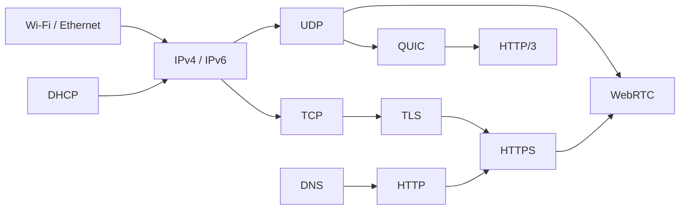

# Карта взаимосвязей

## Как протоколы образуют один процесс

Эта карта показывает **зависимости и взаимодействия**, а не строгую последовательность всех пакетов. Например, DNS может выполняться по UDP или TCP и не всегда предшествует каждому HTTP-запросу.

## Ещё три связи

- **Почта:** DNS/MX → SMTP (отправка и доставка) → IMAP или POP3 (чтение).
- **Защита имён:** DNS + DNSSEC (проверка подлинности) и DNS + DoH (шифрование запроса на пути к резолверу).
- **Защищённый доступ:** SSH (сессия приложения) vs WireGuard/IPsec (IP-туннель).

## Не путать

- *IP-адрес* выбирает узел, *порт* — приложение.
- *Маршрутизация IP* не означает *надёжность TCP*.
- *WPA3* защищает радиоканал, *TLS* — соединение приложения.
- *DNSSEC* даёт подлинность ответа, *DoH* — конфиденциальность передачи запроса на одном участке.
